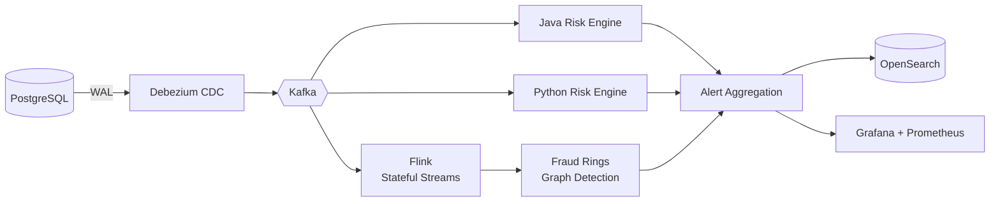
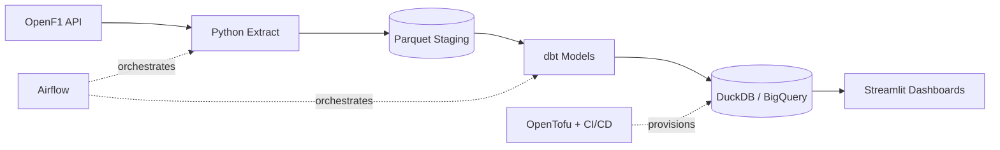

<!-- ============================================================ -->
<!--                    HEADER / HERO BANNER                      -->
<!-- ============================================================ -->

<div align="center">


<a href="https://git.io/typing-svg">
  
</a>

<br/>


<br/><br/>

[](mailto:muindecaleb83@gmail.com)
[](https://www.linkedin.com/in/caleb-muinde-2564a534b/)
[](https://medium.com/@calebmuinde4)
[](https://wa.me/254794501179)
[](https://qu-bit.org/)

</div>

---

## 👨‍💻 About Me

```text
$ whoami
> caleb — data engineer, builder, community co-founder

$ cat focus.txt
> event-driven processing · change data capture · stream processing
> data modeling · query performance · orchestration · observability

$ cat philosophy.txt
> I learn by building systems that resemble real engineering environments,
> not isolated notebooks or proof-of-concept scripts.
```

My work sits at the intersection of **data engineering**, **backend systems**, and **database architecture**. My projects span the data lifecycle, from high-throughput transactional systems to analytical platforms and database operations at scale.

<table>
<tr>
<td align="center" width="25%">🌊<br/><b>Streaming</b><br/><sub>Kafka · Flink · CDC</sub></td>
<td align="center" width="25%">🗄️<br/><b>Databases</b><br/><sub>Postgres · MySQL · SQL Server</sub></td>
<td align="center" width="25%">📊<br/><b>Analytics Eng.</b><br/><sub>dbt · DuckDB · BigQuery</sub></td>
<td align="center" width="25%">☁️<br/><b>Cloud & Infra</b><br/><sub>GCP · Azure · K8s · OpenTofu</sub></td>
</tr>
</table>

---

## 🌍 Building with Qu-Bit

<div align="center">

<a href="https://qu-bit.org/">
  
</a>

**Build production-grade data engineering systems. No fluff. Just architecture, code, and execution.**

</div>

As Co-Founder, I'm helping build an open-source community where data engineers and enthusiasts learn, collaborate, and contribute to practical projects. Qu-Bit covers the **whole data stack**: infrastructure, streaming, analytics, databases, distributed systems, and emerging tech.

| 🌐 Website | 💻 GitHub Org | 💬 Discord |
|:---:|:---:|:---:|
| [qu-bit.org](https://qu-bit.org/) | [QuBitDECommunity](https://github.com/QuBitDECommunity) | [Join the chat](https://discord.com/) |

---

## 🚀 What I'm Building

### ⚡ [Banking Fraud Platform](https://github.com/Caleb-Muinde83/banking-fraud-platform)

<table>
<tr>
<td width="68%" valign="top">

A containerized, **real-time banking and fraud-detection simulation** built on event-driven architecture. Independent **Java and Python risk engines run active-active**, with stateful stream processing, graph-based fraud-ring detection, alert aggregation, and full operational observability.


</td>
<td width="32%" valign="top">

**Highlights**
- 🔁 CDC with Debezium
- 🧠 Stateful stream processing
- 🕸️ Fraud-ring graph detection
- ⚖️ Active-active risk engines
- 📈 Metrics, dashboards & search

</td>
</tr>
</table>



<br/>

### 🗄️ [Enterprise DB Clinic](https://github.com/Caleb-Muinde83/enterprise-db-clinic)

<table>
<tr>
<td width="68%" valign="top">

A **hands-on database engineering lab** that recreates the problems found in production. Using one large-scale e-commerce/fintech dataset, it explores indexing, partitioning, schema drift, corruption recovery, zero-downtime migrations, and version upgrades, with **cross-engine comparison studies**.


</td>
<td width="32%" valign="top">

**Highlights**
- 🧩 Partitioning strategies
- ⚡ Indexing & tuning
- 🔀 Schema drift handling
- 🚚 Zero-downtime migrations
- 🆚 Postgres vs MySQL vs SQL Server

</td>
</tr>
</table>

<br/>

### 🏎️ [Formula 1 Data Platform](https://github.com/Caleb-Muinde83/f1_data_project)

<table>
<tr>
<td width="68%" valign="top">

An **end-to-end ELT platform** that pulls F1 telemetry and race data from the OpenF1 API, stages it as Parquet, transforms it with dbt, and serves analytical models through DuckDB/BigQuery and interactive dashboards. Includes Airflow orchestration, OpenTofu-provisioned cloud infra, CI/CD, and team-radio transcription.


</td>
<td width="32%" valign="top">

**Highlights**
- 🔌 OpenF1 API extraction
- 📦 Parquet staging layer
- 🛠️ dbt transformations
- 🌤️ Airflow + OpenTofu + CI/CD
- 🎙️ Team-radio transcription

</td>
</tr>
</table>



---

## 🛠️ Tech Stack

**Languages**


**Data Engineering & Databases**


**Cloud, Infrastructure & Observability**


---

## 🎓 Certifications

<table>
<tr>
<td align="center" width="20%">
<a href="https://www.credly.com/badges/aede4782-60e1-41db-bc8f-ca2695c1d0cb/linked_in?t=t9wls5">
</a>
</td>
<td align="center" width="20%">
<a href="https://www.credly.com/badges/3c1cce87-ac05-42d0-8e74-21f54816cfd4/linked_in_profile">
</a>
</td>
<td align="center" width="20%">
<a href="https://www.credly.com/badges/0e57c2c8-ce50-485a-bfe7-37666b273b67/linked_in_profile">
</a>
</td>
<td align="center" width="20%">
<a href="https://www.credly.com/badges/aab70a6d-d038-4372-9b61-ed562fcf62e8/linked_in_profile">
</a>
</td>
<td align="center" width="20%">
<a href="https://www.linkedin.com/in/caleb-muinde-2564a534b/overlay/Certifications/709748936/treasury/?profileId=ACoAAFd1rSIB1A0yTTftDkMplZ7-BaCXEfR4yMk">
</a>
</td>
</tr>
</table>

---

## 🧠 Engineering Interests

| | | |
|---|---|---|
| 🔄 **Pipelines**<br/><sub>Reliable batch & streaming</sub> | 🌐 **Distributed Systems**<br/><sub>Event-driven, CDC</sub> | 🏛️ **Data Platforms**<br/><sub>Lakehouse, warehouse, modeling</sub> |
| 🔬 **Database Internals**<br/><sub>Query optimization at scale</sub> | ✅ **Data Quality**<br/><sub>Lineage, observability, resilience</sub> | ☁️ **Cloud & Automation**<br/><sub>Reproducible environments</sub> |
| 🤖 **AI + Data**<br/><sub>ML inside modern platforms</sub> | 🤝 **Open Source**<br/><sub>Collaboration & sharing</sub> | ✍️ **Technical Writing**<br/><sub>Publishing what I learn</sub> |

---

## 📊 GitHub Stats

<div align="center">


</div>

---

## 📬 Connect & Follow My Work

I'm always happy to connect with people building data platforms, distributed systems, databases, and open-source tools.

<p align="center">
  <a href="mailto:muindecaleb83@gmail.com"></a>
  <a href="https://wa.me/254794501179"></a>
  <a href="https://www.linkedin.com/in/caleb-muinde-2564a534b/"></a>
  <a href="https://medium.com/@calebmuinde4"></a>
  <a href="https://qu-bit.org/"></a>
</p>

<div align="center">

### 🔁 Build. Learn. Share. Repeat.

*Explore the repositories above to see the systems, implementation details, and engineering decisions behind my work.*


</div>