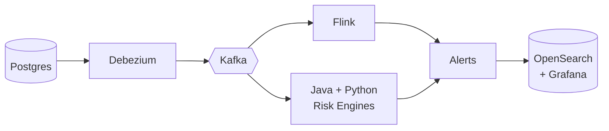
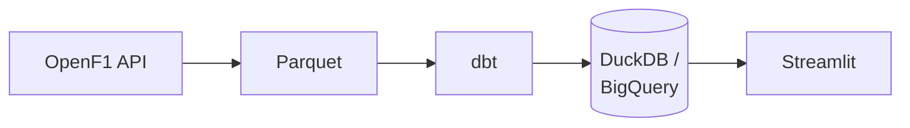

<div align="center">


<a href="https://qu-bit.org/">
  
</a>

<br/>


</div>

<br/>

## 👋 About

I design and build **reliable, production-grade data systems**: the pipelines, databases, and cloud infrastructure that analytics and AI depend on. I learn by building things that resemble real engineering environments, not isolated notebooks.

Today I'm extending that foundation toward **AI and ML**: integrating **local models**, retrieval, and AI workloads into data platforms, so the systems I build are ready for where the industry is heading.

<table>
<tr>
<td align="center" width="25%">
<br/><br/>
<b>Data Engineering</b><br/>
<sub>Streaming, CDC, ELT,<br/>orchestration</sub>
</td>
<td align="center" width="25%">
<br/><br/>
<b>Cloud Architecture</b><br/>
<sub>GCP · Azure · Kubernetes<br/>Infrastructure as Code</sub>
</td>
<td align="center" width="25%">
<br/><br/>
<b>Database Engineering</b><br/>
<sub>Tuning, partitioning,<br/>zero-downtime migrations</sub>
</td>
<td align="center" width="25%">
<br/><br/>
<b>AI / ML Integration</b><br/>
<sub>Local LLMs, RAG,<br/>AI-ready data platforms</sub>
</td>
</tr>
</table>

<br/>

## 🚀 Featured Projects

### ⚡ [Banking Fraud Platform](https://github.com/Caleb-Muinde83/banking-fraud-platform)
> *Real-time, event-driven fraud detection, with two independent risk engines running active-active.*

A containerized banking simulation built on **change data capture**. Transactions flow from PostgreSQL through Debezium into Kafka, where **Flink** handles stateful stream processing and graph-based fraud-ring detection while **Java and Python risk engines** score events in parallel. Alerts are aggregated and surfaced through full observability tooling.

         



<br/>

### 🗄️ [Enterprise DB Clinic](https://github.com/Caleb-Muinde83/enterprise-db-clinic)
> *A hands-on lab that recreates real production database problems, across three engines.*

Using one large-scale e-commerce/fintech dataset, this project works through **indexing, partitioning, schema drift, corruption recovery, zero-downtime migrations, and version upgrades**, with side-by-side comparison studies across PostgreSQL, MySQL, and SQL Server.

       

<br/>

### 🏎️ [Formula 1 Data Platform](https://github.com/Caleb-Muinde83/f1_data_project)
> *End-to-end ELT: from raw telemetry to interactive dashboards.*

Extracts race and telemetry data from the **OpenF1 API**, stages it as Parquet, models it with **dbt**, and serves it through **DuckDB / BigQuery** to Streamlit dashboards. Orchestrated with **Airflow**, provisioned with **OpenTofu**, shipped through **CI/CD**, and extended with team-radio transcription.

        



<br/>

## 🤖 Where I'm Taking My Work: AI-Ready Data Platforms

Good AI depends on good data engineering. I'm building the bridge between the two, applying data-platform discipline to AI workloads and running models **locally**, where cost, privacy, and control matter.

| | Focus | What it means in practice |
|:-:|---|---|
| 🧠 | **Local & open models** | Running and evaluating open-weight LLMs on my own hardware |
| 🔎 | **Retrieval (RAG)** | Embeddings, vector search, and grounding models in trusted data |
| 🏗️ | **AI-ready pipelines** | Clean, versioned, observable data feeding ML and LLM workloads |
| 🔁 | **MLOps foundations** | Reproducible environments, CI/CD, and monitoring for models |

     

<br/>

## 🛠️ Tech Stack

| | |
|:--|:--|
| **Languages** |  |
| **Streaming & Orchestration** |     |
| **Databases & Warehouses** |      |
| **Analytics Engineering** |    |
| **Cloud & Infrastructure** |   |
| **Observability** |   |
| **AI / ML** |    |

<br/>

## 🎓 Certifications

| | Certification | Issued by | |
|:-:|---|---|:-:|
|  | **Professional Data Engineer** | Google Cloud | [Verify ↗](https://www.credly.com/badges/aede4782-60e1-41db-bc8f-ca2695c1d0cb/linked_in?t=t9wls5) |
|  | **Professional Cloud Architect** | Google Cloud | [Verify ↗](https://www.credly.com/badges/3c1cce87-ac05-42d0-8e74-21f54816cfd4/linked_in_profile) |
|  | **Azure Data Fundamentals** | Microsoft | [Verify ↗](https://www.credly.com/badges/0e57c2c8-ce50-485a-bfe7-37666b273b67/linked_in_profile) |
|  | **Kubernetes and Cloud Native Associate (KCNA)** | CNCF / Linux Foundation | [Verify ↗](https://www.credly.com/badges/aab70a6d-d038-4372-9b61-ed562fcf62e8/linked_in_profile) |
|  | **Cloud Developer Associate – AI (HCCDA-AI)** | Huawei | [Verify ↗](https://www.linkedin.com/in/caleb-muinde-2564a534b/overlay/Certifications/709748936/treasury/?profileId=ACoAAFd1rSIB1A0yTTftDkMplZ7-BaCXEfR4yMk) |

<br/>

## 🌍 Community: Qu-Bit

<div align="center">

<a href="https://qu-bit.org/"></a>

**Build production-grade data engineering systems. No fluff. Just architecture, code, and execution.**

</div>

I'm a co-founder of Qu-Bit, an open-source community for learning by building. It covers the whole data stack: infrastructure, streaming, analytics, databases, distributed systems, and now AI.

<div align="center">

[🌐 **Website**](https://qu-bit.org/) &nbsp;·&nbsp; [💻 **GitHub Organization**](https://github.com/QuBitDECommunity) &nbsp;·&nbsp; [💬 **Discord**](https://discord.com/)

</div>

<br/>

## 📊 GitHub Activity

<div align="center">


&nbsp;


</div>

<br/>

## 📬 Get in Touch

I'm happy to connect with people building data platforms, cloud systems, and AI-powered tools, or hiring for them. Copy my email with one click:

```text
muindecaleb83@gmail.com
```

```text
+254794501179
```

<div align="center">

<a href="https://www.linkedin.com/in/caleb-muinde-2564a534b/"></a>
<a href="https://medium.com/@calebmuinde4"></a>
<a href="https://wa.me/254794501179"></a>
<a href="https://qu-bit.org/"></a>

<br/><br/>

**Build. Learn. Share. Repeat.**


</div>
